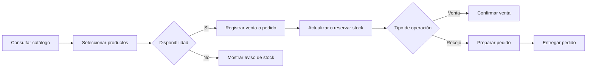

<div align="center">


<br>

# 💚 INKAFARMA
### Sistema de Gestión de Ventas, Recojo de Pedidos e Inventario

**Una propuesta tecnológica para simplificar operaciones de farmacia.**

<br>


<br>

[**📘 Documentación**](docs/) · [**📋 Historias de usuario**](docs/02-historias-usuario/HISTORIAS_DE_USUARIO.md) · [**🧩 Diagramas**](docs/03-diagramas/) · [**🗂️ Kanban**](kanban/) · [**💻 Prototipo**](src/frontend/)

</div>

---

## 🌿 Sobre nuestro proyecto

**InkaFarma – Sistema de Gestión** es una propuesta desarrollada para el curso de **Ingeniería de Software**. Integra en una misma solución el registro de ventas, la solicitud y el recojo de pedidos, y el control de inventario. Buscamos organizar los procesos, evitar inconsistencias de stock y facilitar el seguimiento de cada pedido.

> [!IMPORTANT]
> **Proyecto académico no oficial.** No representa a Inkafarma ni mantiene relación comercial con la empresa. Utiliza información y datos ficticios. No está preparado para operar una farmacia real.

## ✨ Nuestros módulos

<table>
<tr>
<td width="50%" valign="top">

### 🛒 Ventas

- Catálogo y búsqueda de productos.
- Carrito y cálculo de importes.
- Registro simulado de ventas.
- Validación de disponibilidad.

</td>
<td width="50%" valign="top">

### 📦 Recojo de pedidos

- Registro de solicitudes de recojo.
- Consulta del estado del pedido.
- Preparación y entrega simuladas.
- Seguimiento del ciclo del pedido.

</td>
</tr>
<tr>
<td valign="top">

### 🧮 Inventario

- Entradas y salidas de productos.
- Control de stock disponible.
- Alertas de existencias mínimas.
- Registro propuesto de movimientos.

</td>
<td valign="top">

### 📊 Reportes y usuarios

- Resúmenes básicos de operaciones.
- Consulta de productos y pedidos.
- Roles de usuario **planificados**.
- Reportes para apoyar decisiones.

</td>
</tr>
</table>

## 🎯 Objetivos del sistema

1. Centralizar las operaciones de **venta, recojo de pedidos e inventario**.
2. Mejorar la trazabilidad de los pedidos desde su registro hasta su entrega.
3. Reducir errores asociados al control manual de existencias.
4. Aplicar **Kanban** para planificar y visualizar el trabajo del equipo.

## 🔄 ¿Cómo funciona el proceso?



*Este diagrama representa el flujo funcional previsto; no implica que todos los pasos estén implementados.*

## 🗂️ Gestión ágil con Kanban

Usamos **GitHub Issues + GitHub Projects** para visualizar tareas, responsabilidades y estado de avance.

| 📥 Backlog | 📝 Por hacer | 🚧 En progreso | 🔎 En revisión | ✅ Hecho |
|:---:|:---:|:---:|:---:|:---:|
| Tareas identificadas | Tareas priorizadas | Desarrollo activo | Validación y pruebas | Tareas aceptadas |

**Reglas de trabajo:** cada tarea tiene responsable y criterios de aceptación; trabajamos con un límite recomendado de dos tareas simultáneas por integrante; las tarjetas solo pasan a **Hecho** cuando cumplen su definición de terminado.

**📌 [Consulta el backlog y las instrucciones para armar el tablero](kanban/README.md)** · [Guía de GitHub Projects](docs/07-gestion/CONFIGURAR_GITHUB_PROJECTS.md)

<!-- Cuando crees el proyecto en GitHub, cambia esta línea por el enlace REAL:
[🚀 Abrir nuestro tablero Kanban](https://github.com/users/TU-USUARIO/projects/NUMERO)
-->

## 🧰 Herramientas del proyecto

<div align="center">


</div>

- **Prototipo actual:** HTML, CSS y JavaScript, con datos de demostración en el navegador.
- **Base de datos:** esquema SQL de referencia, aún sin integración operativa.
- **Gestión colaborativa:** Git, GitHub Issues, Pull Requests y Projects.
- **Backend y autenticación:** por implementar; la tecnología definitiva está pendiente de elección.

## 📂 Organización del repositorio

```text
inkafarma-sistema-gestion/
├── 📄 README.md                    # Presentación del proyecto
├── 🖼️ assets/images/               # Portada e imágenes
├── 📚 docs/                        # Requisitos, historias, diagramas y pruebas
├── 🗃️ kanban/                       # Backlog y plantillas de tareas
├── 💻 src/
│   ├── frontend/                   # Prototipo demostrativo
│   ├── backend/                    # Arquitectura / implementación pendiente
│   └── database/                   # Esquema SQL de referencia
├── 📑 entregables/                 # Material de presentación
├── ⚙️ .github/                     # Plantillas de Issues y PR
└── 📄 COMO_SUBIR_A_GITHUB.md       # Guía de publicación
```

## ▶️ Ejecutar el prototipo

1. Descarga o clona este repositorio.
2. Abre el archivo [`src/frontend/index.html`](src/frontend/index.html) en tu navegador.
3. Explora las pantallas con **información ficticia**.

> **Estado real:** actualmente es un prototipo local. No dispone de API, autenticación de servidor, sincronización entre usuarios ni persistencia segura.

## 👥 Nuestro equipo

> ✍️ Completar los nombres y usuarios de GitHub con los datos reales del grupo.

| Integrante | Responsabilidad propuesta | GitHub |
|:---|:---|:---|
| **Integrante 1** | Coordinación y análisis de requisitos | `@usuario1` |
| **Integrante 2** | Interfaz y experiencia de usuario | `@usuario2` |
| **Integrante 3** | Lógica del sistema y backend | `@usuario3` |
| **Integrante 4** | Base de datos, inventario y pruebas | `@usuario4` |

**Curso:** Ingeniería de Software · **Metodología:** Kanban · **Institución/docente:** *por completar*

## 🧭 Hoja de ruta

- [x] Organizar la documentación inicial, las historias de usuario y el backlog.
- [x] Crear un prototipo local demostrativo.
- [ ] Completar revisiones de requisitos y prototipo.
- [ ] Implementar backend, persistencia y control de acceso.
- [ ] Validar casos de prueba de integración.
- [ ] Presentar una demostración de la versión final.

## 🤝 Forma de colaboración

1. Selecciona o crea un **Issue** del backlog.
2. Asigna un responsable y define los criterios de aceptación.
3. Crea una rama con nombre `feature/numero-descripcion`.
4. Registra los cambios y abre un **Pull Request**.
5. Revisa y prueba antes de fusionar; luego actualiza Kanban.

Consulta la [definición de terminado](docs/07-gestion/DEFINICION_DE_TERMINADO.md) y las [plantillas de Issues](.github/ISSUE_TEMPLATE/).

---

<div align="center">

### 💚 Tecnología para una gestión más ordenada

**Proyecto académico de Ingeniería de Software • 2026**

*Construido en equipo, gestionado con Kanban.*

</div>
